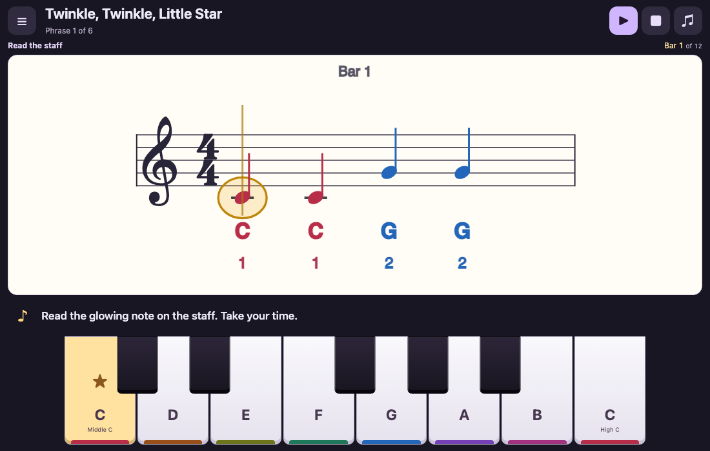
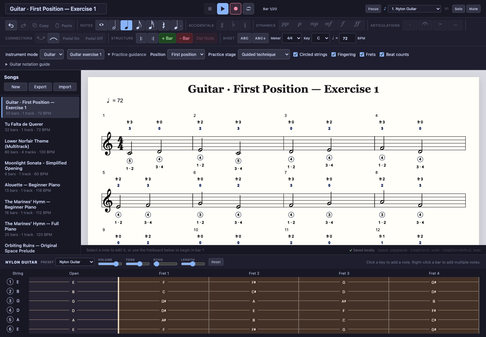

# Piano Sheet

A local-first piano notation editor built with React, TypeScript, VexFlow, and Tone.js. Compose on a grand staff, enter notes or chords from a full 88-key on-screen piano, annotate a score, and play it back with synchronized visual guidance.

<a href="https://kennycason.com/piano/" target="_blank">Demo</a>

## Screenshots

<p align="center">
  
</p>

<p align="center">
  
  
</p>

<p align="center">
  
  
</p>

## Current capabilities

- Grand-staff or single-staff notation with responsive measure wrapping
- Multiple independent rhythmic voices on either staff, including selectable/editable same-staff notes
- Full-width 88-key piano input for notes and explicit chord building/editing
- Five note durations, dotted notes, accidentals, dynamics, and articulations
- Standard key signatures and per-rest vertical positioning
- Correct measure-scoped accidentals plus ties and slurs across bar and system boundaries
- Pedal markers, repeat markers, fermatas, and measure management
- A playable keyboard synth with 13 pitched/percussion presets plus volume, tone, echo, and note-length controls
- Playback with pause, resume, seamless whole-song looping, repeats, sustained pedal, fermata timing, dynamics, articulations, and a moving score cursor
- Focus mode: two large bars that advance with playback and fit the screen height, chord names by the bass staff, accidental reminders on treble notes, and a labeled keyboard trimmed to the song's range. Browse pairs with the arrow buttons while stopped; Play starts from the displayed pair.
- Simultaneous score-note and piano-key highlighting across staves for each note's full written duration, retained while paused, with immediate release during playback and consistent guidance in focus mode
- Two optional pitch-letter views: letters centered inside noteheads, or high-contrast note/chord labels below; either mode also labels every key on the piano
- Note, chord, rest, and whole-bar copy/paste with undo/redo and keyboard shortcuts
- Multiple locally saved songs with versioned, validated JSON import/export and recovery-safe saves
- Track-aware MIDI import with chord, hand/staff, overlapping-voice, percussion, General MIDI instrument, tempo, meter, and key mapping
- Multitrack score navigation with per-track notation, sounds, keyboard lighting, mute/solo, and full-arrangement playback
- Responsive touch-friendly mobile editing, keyboard-accessible score actions, and non-blocking song deletion with undo
- Ten bundled, editable sample projects for learning and exploring the editor

Songs, tracks, and each track's selected sound controls are stored in browser `localStorage`. The starter library opens Alouette on a visitor's first run and also includes Tu Falta de Querer, the multitrack Lower Norfair theme, Moonlight Sonata, beginner and full-piano versions of The Marines’ Hymn, Orbiting Ruins, Pixel Parade, and the shared-bass-staff Teacher Duet. Returning visitors keep their previously selected project. There is no account, server, or cloud sync yet. Grand-piano samples are fetched from the Tone.js Salamander sample host; if they are unavailable, playback falls back to Electric Keys. Synthesized instruments and drums do not require sample downloads.

MIDI files are converted into ordinary editable project tracks and are never played directly after import. Every non-empty MIDI track remains independently navigable, retains its channel/program metadata, receives a matching starter sound, and participates in ensemble playback. Percussion becomes an editable percussion-clef score with General MIDI drum labels and synthesized drum sounds. Notes are quantized to the nearest sixteenth; simultaneous notes of equal length become chords, pitched notes below middle C are assigned to bass, and overlaps become independent voices. Secondary-voice timing gaps remain as invisible spacing rests. The import summary calls out tempo, key, meter, or quantization compromises; JSON remains the lossless project format.

## Run locally

```bash
npm install
npm run dev
```

Vite prints the local URL, usually `http://localhost:5173`.

## Production deployment

The production build is configured for the `/piano/` URL path. Build the app, then copy the contents of `dist/` into the server's `piano/` directory:

```bash
npm run build
```

The resulting entry point is `/piano/index.html`, with its JavaScript, CSS, and public assets loaded from `/piano/`.

## Quality checks

```bash
npm run lint
npm test
npm run build
```

The unit suite covers score timing and accidentals, cross-bar/chord ties, repeat expansion, per-note keyboard/score guidance (including Alouette, overlapping voices, pause/resume, and loops), schema migration and validation, every checked-in song fixture, recovery-safe storage, and multi-track MIDI conversion. GitHub Actions runs lint, tests, and the production build on every push and pull request. Browser-level interaction coverage is the next testing priority.

## Project map

- `src/App.tsx` — editor state, history, commands, and keyboard shortcuts
- `src/models/song.ts` — persisted score data and timing helpers
- `src/models/editorCommands.ts` — shared note copying, transposition, staff hit mapping, and accidental normalization
- `src/services/renderer.ts` — VexFlow score layout and note hit targets
- `src/services/playback.ts` — Tone.js instruments, transport scheduling, and synchronized playback callbacks
- `src/services/playbackVisuals.ts` — score-duration highlight snapshots shared by the score and keyboard; independent of audio sustain, with position-based lookup for track changes, resume, and loops
- `src/services/storage.ts` — local persistence and validated JSON import/export
- `src/services/midi.ts` — quantized MIDI-to-score conversion and track/voice mapping
- `src/components/` — transport, notation toolbar, song library, and piano input
- `songs/` — importable reference scores and regression fixtures

## Editing model

New songs begin with four empty measures. Click an empty part of a bar to select it; piano input then stays in that bar. Adding a new bar selects it immediately. With no bar or note selected, piano input begins in bar 1. Automatic advance only applies when there is no explicit bar target.

For multitrack projects, use the track picker in the top bar to switch the visible score and keyboard sound. **Solo** plays only the visible track; **Mute** removes it from ensemble playback. Playback normally performs every unmuted track while score and keyboard highlights follow the visible track.

To add a slur, click the arc tool and then select its starting and ending notes. Selecting the same pair again removes the slur; press `Escape` to cancel partway through.

Right-click a bar and choose **Add note(s)** to enter simultaneous notes. Each piano key updates the bar immediately; click an active key again to remove that pitch, press `Enter` to keep the result, or **Cancel**/`Escape` to restore the bar. Right-click an existing note or chord to edit or delete it. A selected note or chord can also be dragged vertically to transpose it; clicking empty staff space directly above or below its notehead adds a natural pitch to the chord.

Useful shortcuts:

- `1`–`5`: whole, half, quarter, eighth, or sixteenth duration
- `R`: toggle rest entry
- `.`: toggle dotted entry
- Arrow left/right: select adjacent notes
- Arrow up/down: move the selected note by a staff step, or nudge a selected rest vertically
- `T`: toggle tie
- `Delete`/`Backspace`: delete selected note
- `Cmd/Ctrl+C`: copy the selected note, chord, rest, or bar
- `Cmd/Ctrl+V`: paste a note after the selection, or duplicate a copied bar after the selected bar
- `Space`: play, pause, or stop loading
- `Escape`: cancel the current slur or note-entry session
- `Cmd/Ctrl+Z`: undo; `Cmd/Ctrl+Shift+Z` or `Ctrl+Y`: redo

## Practice and lessons



[Two-bar reading preview](./screenshots/practice-reading-two-bars.png) · [Small screen](./screenshots/practice-small-screen.png) · [Left settings drawer](./screenshots/practice-settings-drawer.png)

The app opens in **Little Piano Club**, a full-screen practice view for a small screen. **☰** opens a left overlay drawer with songs, lesson activities, phrase selection, piano input, reading help, and band settings. The main view shows the staff, a single prompt, playback controls, and the keyboard. Choose **Score editor ↗** in the drawer to reach the editor; **★ Practice & lessons** returns to practice. The beginner songs are **Twinkle, Twinkle, Little Star**, **Mary Had a Little Lamb**, and **Ode to Joy**. Each has a melody demo, short phrases, optional finger hints, and locally synthesized backing tracks: a dreamy lullaby or a little pop band. Practice audio needs no sample downloads.

Practice opens directly into the first staff-reading phrase. Complete a phrase and press **Next →** to move through the song, then play with the band. A listening activity leads into the first phrase after the demo. Music reading is the main guide in phrase lessons, listening, and band performances. A large **treble staff** shows **one bar by default**, or **two bars** with the bar selector. The staff slides horizontally as the current note reaches a new bar. In phrase mode it waits for the correct pitch; during demos and performances it follows the audio clock. Quarter, half, whole, dotted, and eighth notes use standard notation, including middle C’s ledger line.

**Reading help** gradually removes the supports: **Colors + names** shows colored notes, letter names, finger numbers, and a glowing key; **Colors only** keeps matching note/key colors but removes names and finger/key prompts; **Read the staff** shows plain notation and an unlabeled keyboard. **Finger hints** and **Glowing key hint** can also be changed independently. The chosen help and one/two-bar view save on this device. Wrong-note feedback in the reading modes points back to the staff without supplying the pitch name.

The suggested 60-minute session contains 5 minutes finding keys, 5 listening and clapping, 15 learning phrases, 10 with the band, a 5-minute wiggle break, a 10-minute performance, and 10 making up music. These are suggestions: switch activities freely, pause the timer, or end early. Opening the drawer, pausing playback, or hiding the tab pauses the practice timer. Playback pauses when the drawer opens or the tab is hidden; resume when ready. Phrase mode waits for the correct pitch and offers another try without a penalty. Band mode gives a four-beat count-in, then checks pitches near their beat onsets. Stars reflect matched melody notes (one at any positive score, two at 60%, three at 85%); this first version does not assess held-note duration, posture, or technique. Phrase milestones and best performances save on this device across visits.

**Space** starts, pauses, or resumes practice. Pause keeps the note position and accompaniment clock; **Shift+Space**, **Escape**, or **■** stops and resets the attempt. Space also cancels audio while it is loading. These shortcuts leave drawer controls free to work normally. Use **♫** to hear the melody.

In the drawer, choose **On-screen keys**, **USB / MIDI piano**, or **Microphone**. Live input is also available below the score editor. MIDI supports device selection, hot plugging, velocity-zero note releases, and held-key lighting. In the editor, Record adds notes using the selected written duration; attacks within 35 ms become a chord. It is step entry, not a recording of performance timing. Turning Record off lets you play without changing the score. Input is ignored during score playback, and microphone pitches are never echoed through the synth.

MIDI requires a browser with Web MIDI support (Chrome or Edge are practical choices). MIDI and microphone access require HTTPS or localhost and permission through the browser. Microphone mode estimates **one pitch at a time**, with a noise-floor slider; it cannot recognize chords reliably. It disables backing and beat clicks when connected. Use headphones before enabling accompaniment, and while listening to demos, to avoid detecting sound from the app. Repeated notes need clear new strikes or a short release; room noise and acoustic-piano harmonics may affect detection. Audio is analyzed locally without recording or uploading it. Switching inputs or leaving Practice releases the microphone stream and MIDI listeners.

**Open melody + backing in score editor** creates a normal editable two-track project. Use the existing Mute/Solo controls to hear the melody, the accompaniment, or both; JSON export preserves the arrangement. This does not change your existing songs.

Practice is separated from the notation editor: `src/models/lessons.ts` owns the curriculum, score generation, and assessment; `src/services/liveInput.ts` owns MIDI and pitch detection; `src/hooks/useLiveInput.ts` owns browser-resource lifetimes; `src/services/practiceAudio.ts` owns the independent synth and audio-clock scheduler; `src/models/practiceReading.ts` owns reading preferences and bar windows, and `src/services/practiceStaff.ts` engraves the scrolling VexFlow staff. `src/components/Practice/` and `src/components/LiveInput/` own the practice interface and shared input controls.

Browser regression checks cover saved phrase milestones, demos without lesson credit, MIDI unplugging and cleanup, microphone pitch input and cleanup, denied permission, band scoring, the one-screen portrait/landscape layout, keyboard transport, preserved audio clocks, and drawer focus management:

```bash
npx playwright install chromium
npm run test:e2e
```

## Guitar mode

Choose **Guitar exercise 1** in the instrument controls to open the photographed 20-bar C-major first-position study. Its tempo is an editorial 72 BPM. Guitar mode uses a single treble staff, a standard-tuning six-string fretboard, and a locally synthesized nylon-string preset with no sample downloads. Written guitar notes sound one octave lower; score and fretboard guidance follow the written pitches. New projects inherit the active instrument mode.

Toggle **Circled strings**, **Fingering**, **Frets**, and **Beat counts** independently, or choose **Guided technique**, **Read with hints**, or **Independent reading** to reduce the assistance. These preferences are saved on each track and are available in Focus mode. String 1 is high E; string 6 is low E. Guitar finger 0 means an open string, and 1–4 mean index through little finger.

The shared rules live in `src/models/guitar.ts`: `GUITAR_PROFILES` defines fret ranges and finger mapping, `GUITAR_STAGES` defines progression defaults, and `GUITAR_LAYERS` defines the controls. Every guitar score uses the same resolver; the exercise contains ordinary notes, with no lesson-specific annotation code. First and fifth position are available. Suggestions respect accidentals, reserve distinct strings for chord tones, and leave pitches outside the selected position unannotated.

Select a note and expand **Selected note positions** to override its string/fret or finger, or return to the automatic guide. JSON stores `instrumentMode`, `guitar.profile`, and `guitar.layers` on the track. Optional note-level `guitarPositions` entries align with `keys` and contain `{ "string": 5, "fret": 3, "finger": 3 }`; `null` uses the guide. Guitar settings and overrides survive JSON export/import and undo/redo. Changing a note's pitches clears its overrides so the guide can recalculate them.

<p align="center">
  
</p>

## Product plan

See [ROADMAP.md](./ROADMAP.md) for the current priorities, known limitations, and recommended order of work.
